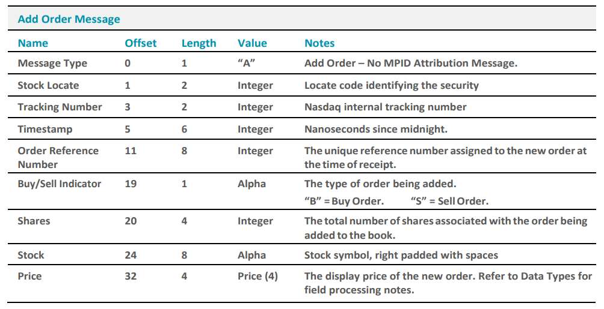
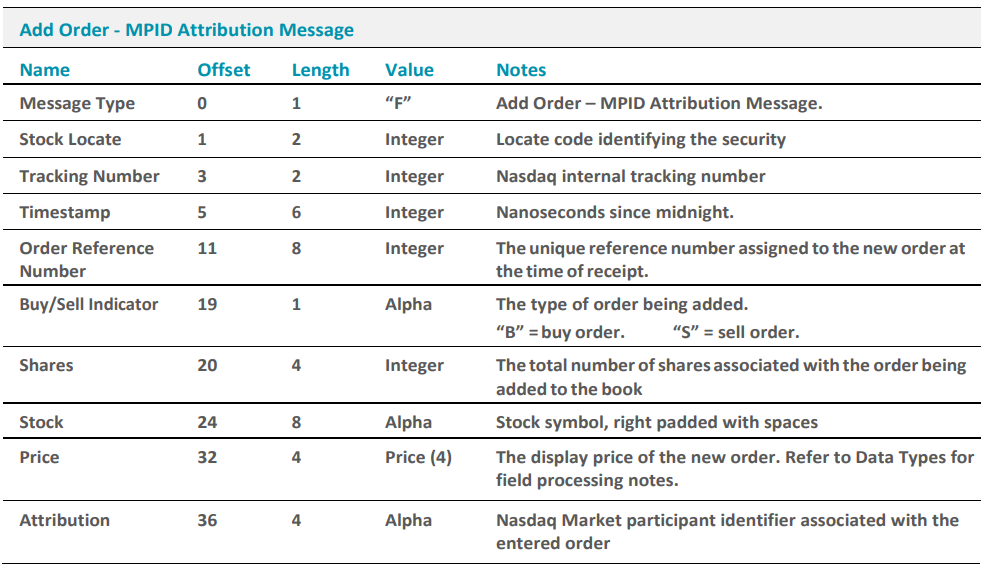
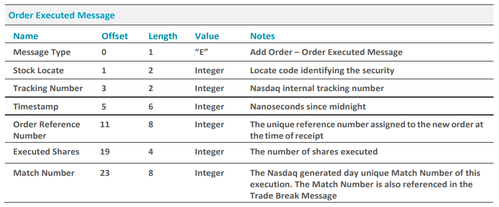
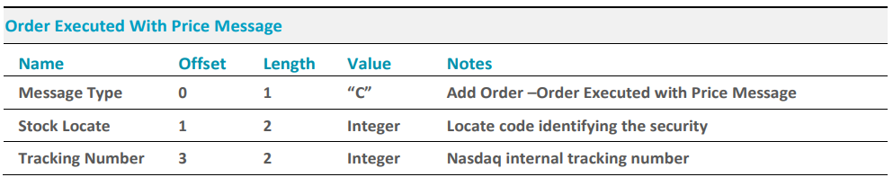
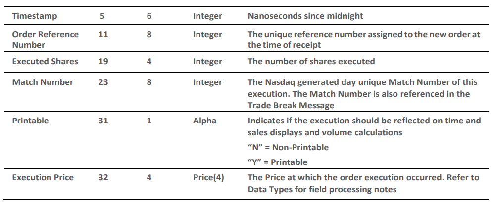
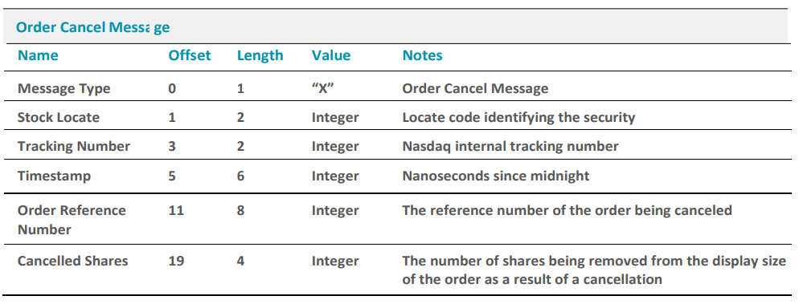
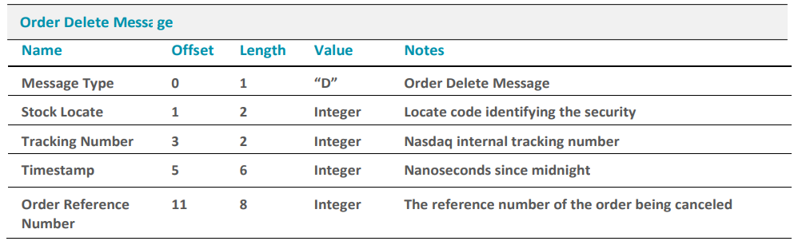
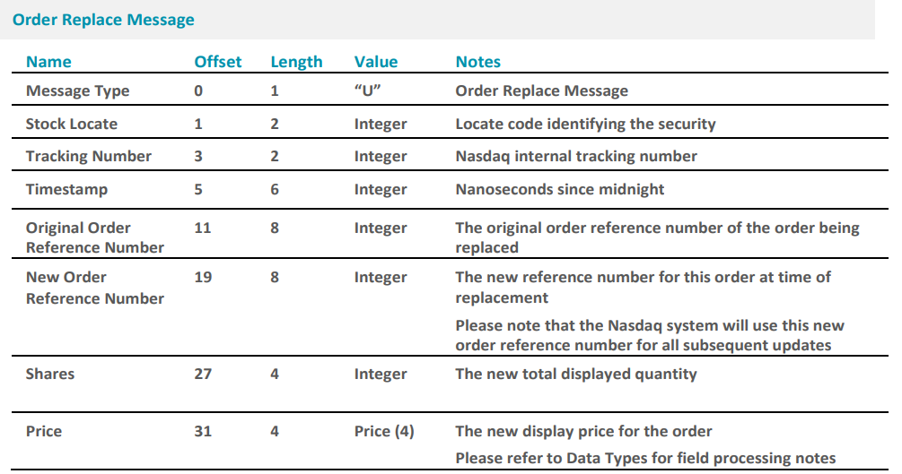

# Nasdaq Totalview ITCH 5.0 Notes 
Source: https://www.nasdaqtrader.com/content/technicalsupport/specifications/dataproducts/NQTVITCHspecification.pdf
# Messages that do not modify book state
|Message Type | msgType | total length|
|--|--|--|
System Event Messages | S | 12
Stock Related Messages | R | 39
Stock Trading Action | H | 25
Reg SHO Short Sale Price Test | Y | 20
Market Participant Position | L |  26
MWCB Decline Level | V |  35
MWCB Status | W | 12
IPO Quoting Period Update | K | 28
LULD Auction Collar | J | 35
Operational Halt | h | 21
NOII | I | 50
RPII | N | 20
Direct Listing with Capital Raise | O | 48
Trade (Non-Cross) | P | 44
Cross Trade | Q | 40
Broken Trade | B | 19

# Messages that modify book state
|Message Type | msgType | Total Length (Bytes)|
|--|--|--|
Add Order (No MPID) | A | 36
Add Order with MPID | F | 40
Order Executed | E | 31
Order Executed with Price | C | 36
Order Cancel | X | 23
Order Delete | D | 19
Order Replace | U | 35

**Add Order : No MPID Attribution**

**Add Order with MIPD**

**Order Executed**
- sent whenever an order on book is excuted in whole or in part
- possible to recieve several Order Exectued Message for the same order reference number if that order is excuted in several parts
- by combining executions from Order Executed Messages and Trade Message, possible to build a complete view of all non-cross executions that happen on Nasdaq 

**Order Executed with Price**

**Order Cancel**
- sent whenever order on the book is modified as a result of partial cancellation

**Order Delete Message**
- sent whenever order on book is being cancelled.
- All remaining shares are no longer accessible so the order must be removed from the book

**Order Replace Message**
- sent whenever order on book has been cancel-replaced
- all remaining shares from the original  are no longer accesible, and must be removed
- new order details are provided for the replacement, along wit hteh new order reference number which will be used henceforth
- Since the side/stock symbol/attribution (if any) cannot be changed by an Order Replace event, these fields are not included in the message
  - should retain the side/stock symbol and MPID from original Add Order message

