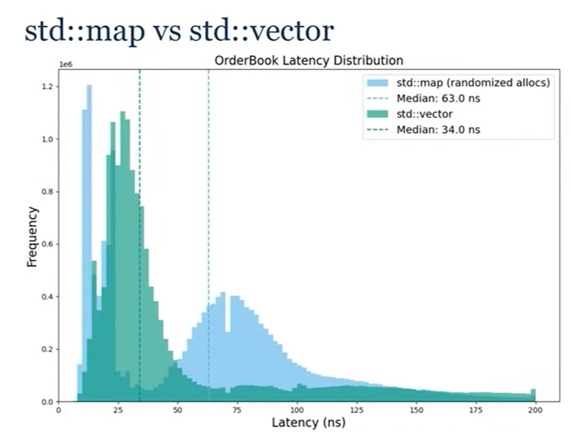
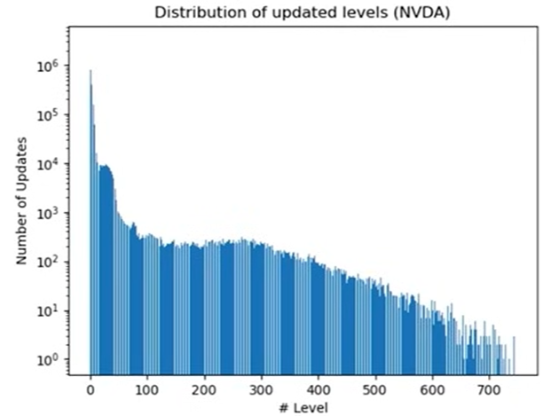
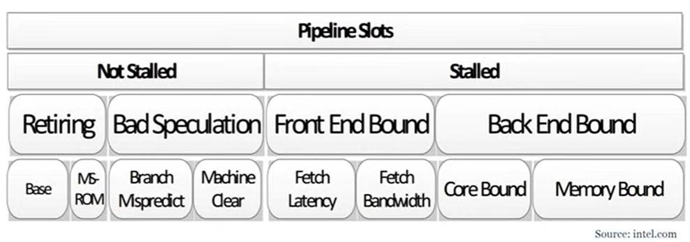
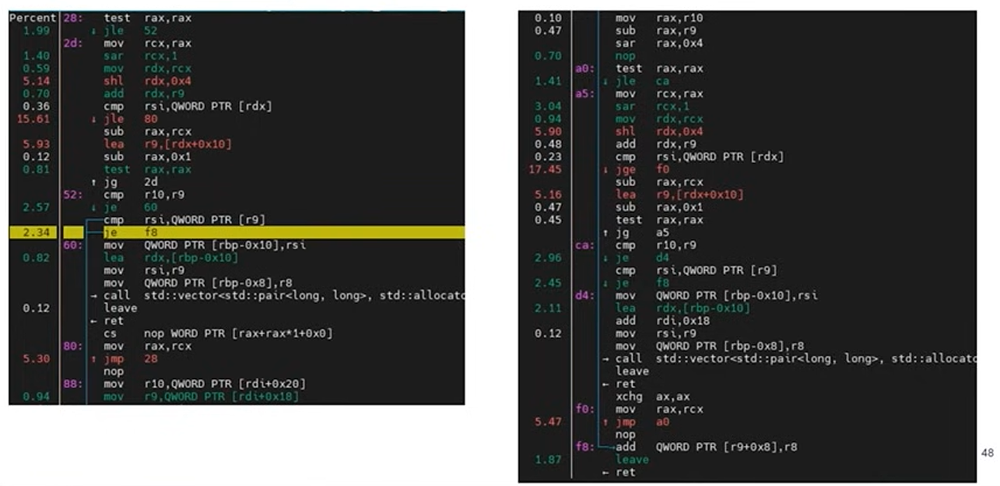
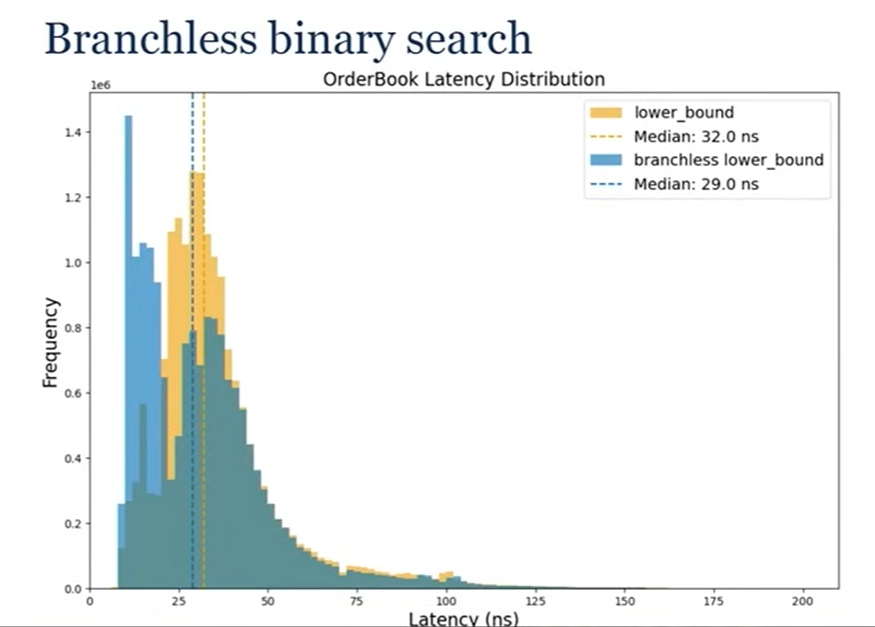
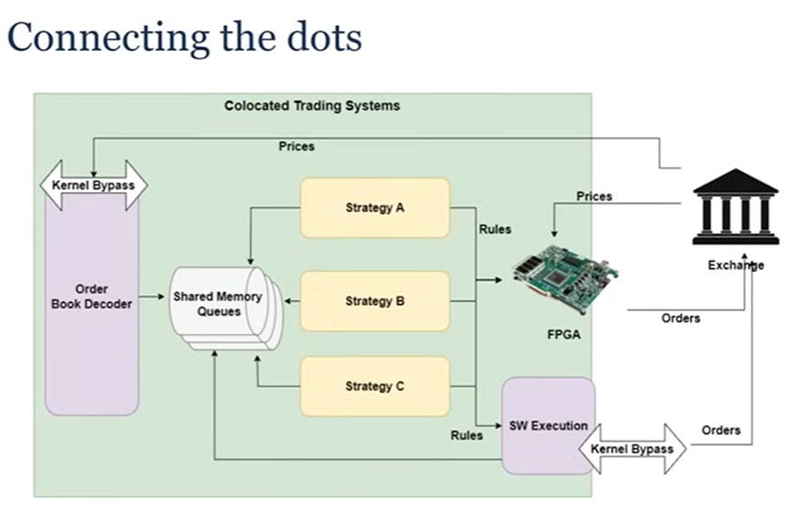
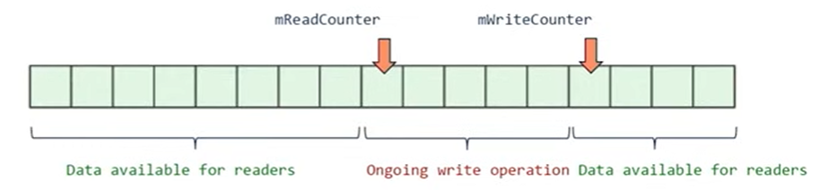
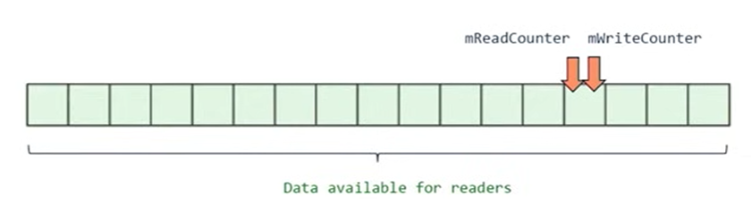

# Orderbook Takeaways from "David Gross - CppCon 2024"

(https://www.youtube.com/watch?v=sX2nF1fW7kI&t=4499s)

Properties:
Two ordered sequences

- Bids: highest to lowest price
- Ask: lowest to highest price

Price Level

- Price
- Size: sum of all orders' size at this price level

Each Order has an ID (uint64_t) which is unique throughout the trading session (day)

API:

```c
enum class Side {Bid, Ask};
// in reality, those would be strong types
using OrderId = uint64_t;
using Volume = int64_t;
using Volume = int64_t;

void AddOrder(OrderId orderId, Side side, Price price, Volume volume);
void ModifyOrder(OrderId orderId, Volume newVolume);
void DeleteOrder(OrderId orderId);
```

No matter what data structure we choose for Orderbook, we need hash map

```c
void AddOrder(uint64_t orderId, Side side, Price price, Volume volume) {
  ...
  auto [it, inserted] = mOrders.emplace(orderId,...);
  EXPECT(inserted, "duplicate order");
  ...
}

void DeleteOrder(uint64_t orderId) {
  auto it = mOrder.find(orderId);
  EXPECT(it != mOrders.end(), "missing order");
}
```

## implementation 1 (std::map)

```c
std::map<Price, Volume, std::greater<Price>> mBidLevels;
std::map<Price, Volume, std::less<Price>> mAskLevels;

template <class T>
typename T::iterator AddOrder(T& levels, Price price, Volume volume){
  auto [it, inserted] = levels.try_emplace(price, volume);
  if (inserted==false)
    it -> second += volume;
  return it;
}

template <class T>
void DeleteOrder(typename T::iterator it, T& levels, Price price, Volume volume){
  it->second -= volume;
  if (it->second <= 0)
    levels.erase(it);
}
```

we can store iterator in hashmap

- since we are already doing hashmap lookup so might as well use that

AddOrder: log(N)
ModifyOrder: amortized constant
DeleteOrder: amortized constant

- std::map iterators are stable, meaning we can store it in our order data (in hash table)


important to look at latency distribution on the whole Orderbook

- if just looking a few percentile or median average or min/max you'd be missing some information
- gathered full week of market data on a dozen of stocks (run benchmark of performance on how it performs on real data)
- 2 peaks
  - one on very left for modify/delete, when you only do hashmap lookup
  - on right, when it goes through binary tree

Yellow distribution is bit of a lie

## Principles 1 : Most of the time you don't want node containers

- Blue distribution is the true distribution
  - between the orderbook operations, add some memory allocations
  - not to do much with them, but to randomize the heap
  - we are checking/measuring the cache locality of std::map, we know its poor since its a node container
  - in production very rare, there is zero dynamic memory allocation, always some around
  - by adding randomized allocations, we are replicating this pattern

## implementation 2 (std::vector)

using 2 vectors (bids and asks) and use std::lower_bound (binary search)

```c
std::vector<std::pair<Price, Volume>> mBidLevels;
std::vector<std::pair<Price, Volume>> mAskLevels;

void AddOrder(Side side, Price price, Volume volume) {
  if (side == Side::Bid)
    return AddOrder(bidLevels,price, volume, std::greater<Price>());
  else
    return AddOrder(bidLevels,price, volume, std::less<Price>());
}

template <class T, class Compare>
void AddOrder(T& levels, Price price, Volume volume, Compare comp) {
  auto it = std::lower_bound(levels.begin(), levels.end(), price,
            [comp](const auto& p, Price price) { return comp(p.first, price);});
  if (it != levels.end() && it->first == price) {
    it -> second += volume;
  else
    levels.insert(it, {price, volume});
}
}
```

AddOrder

- log(N) if price level exists
- log(N) + N if new price level is inserted

ModifyOrder: log(N)

- We can't store iterators/pointers as they are being invalidated on call to std::vector::insert

DeleteOrder:

- log(N) if price level exists
- log(N) + N if new price level is inserted



This latency distribution is just fine (not good)

- has a fat tail

## Principles 2 : Understanding your problem (By looking at data!)

Where does this tail come from? Need to look at data


- looking at the distributions of the data levels
- the actions are happening on the top of our book (highest for bid, lowest for ask)
- what this means for data structure
  - we put best price at index 0
  - as a result we are going to shift continously our elements in vector in memory all the time

## Principles 3 : Hand tailored (specialized) algorithms are key to achieve performance

Solution: "reverse" Vector

- "best" price" or "top" is at end of collection
- minimizes number of copies

```c
void AddOrder(Side side, Price price, Volume){
  if (side == Side::Bid)
    return AddOrder(bidLevels, price, volume, std::less<Price>());
  else
    return AddOrder(askLevels, price, volume, std::greater<Price>());
}

auto GetBestPrices() const {
  return {mBidLevels.rbegin().first, mAskLevels.rbegin()).first};
}
```


Result:

- much nicer latency distribution, the tail is nearly completely gone

## perf usage

```c
void RunPerf(){
  pid_t pid = fork();
  if (pid == 0) {
    const auto parentPid = std::to_string(getppid());
    std::cout<< "Running perf on parent process " << parentPid << std::endl;
    execlp("perf", "perf", ..., parentPid.c_str(), (char*)nullptr);
    throw std::runtime_error("execlp failed");
  }
}

void InitAndRunBenchmark() {
  InitBenchmark(); // might take long time!
  RunPerf();
  RunBenchmark();
}
```

- approach won't work for a micro benchmark / if benchmark really short
- don't want to measure anything about the initalization phase
- First perf measurement should never be too specific

```bash
perf stat -I 10000 -M Frontend_Bound, Backend_Bound, Bad_Speculation, Retiring -p pid
```



- from Intel, top down micro architecture analysis method
- there is very little overlap between them, and not missing anything on what your CPU is doing

in the best case:

- every single instruction per cycle is going to be retired (100%)
- no bad speculation (usually caused by branch misprediction)
- no front end bound (around decoding instruction)
- no back end bound (around memory)

Results:

```
## counts          unit                                                        events
43194329517       de_src_op_disp.all:u                           ##    25.0 %  bad_speculation
139867893         ls_not_halted_cyc:u                            ##    26.4 %  retiring
221623534         ex_ret_ops:u
151118175         de_no_dispatch_per_slot.backend_stalls:u       ##    17.9 %  backend_bound
140413328         ls_not_halted_cyc:u
2580129495        de_no_dispatch_per_slot.no_ops_from_frontend:u ##    30.6 %  frontend_bound
1404946340        ls_not_halted_cyc:u
```

- 25% bad_speclation is very high

```bash
perf record -g -p <pid>
```



- what we see is that more than 30% of CPU time is spent on 2 conditional jump in std::lower_bound
  - its a binary search, CPU predictor is gonna struggle with the updates we have

## Solution: Branchless binary search

```c
template <class ForwardIt, class T, class Compare>
ForwardIt branchless_lower_bound(ForwardIt first, ForwardIt last, const T& value, Compare comp)
{
    auto length = last - first;
    while (length > 0) {
        auto half = length / 2;
        // Multiplication by 1 encourages GCC to generate a CMOV.
        first += comp(first[half], value) * (length - half);
        length = half;
    }
    return first;
}
```

- difference from traditional binary search is that there is no early exit anymore
- going to go through the entire collection no matter what, touching more memory



- got a nice speed up
- again have 2 peaks in our distribution
  - speculate that its due to branchless binary search is tounching more memory

## Principle 4 : Simplicity is the ultimate sophistication

How do we go faster from here (Linear search)

The best implemenation we can find and is the fastest is linear search


- very narrow and no tail

## Principle 5 : Mechanical sympathy

- you want algorithm that are in harmony with your hardware
- which is what linear search is doing perfectly
  - great for cache locality, the way you access memory, branches ...

## Lambda, Functor vs std::function

```c
OrderBook::OrderBook() :
    mBidsCompare([](const std::pair<Price, Volume>& p, Price price) { return p.first < price; }),
    mAsksCompare([](const std::pair<Price, Volume>& p, Price price) { return p.first > price; })
{}

void AddOrder(Side side, Price price, Volume volume)
{
    if (side == Side::Bid)
    {
        return AddOrder(mBidLevels, price, volume, mBidsCompare);
    }
    else
    {
        return AddOrder(mAskLevels, price, volume, mAsksCompare);
    }
}
```

Lambda and Functor are awesome, because the compiler knows the type, so we can really go far into the optimization

- if you were to use std::function (passing it in constructor)
  - the consequences would be huge for the performance of this data structure
  - you lose type information (std::function has type erasure) so the code generated would be very different
  - performance would be terrible

## Refactor plan

- use uint64_t for orderId
- have custom struct for Side, Price, Volume (Price.value)
- make operations like AddOrder/DeleteOrder void, and have it assertion if error happens (via EXPECT macro/assertion helper)
- create assertion helper EXPECT(condition, "message")
- instead of creating Orderbook::buy/sell and Orderbook::cancelSell/cancelBuy with dupe logic, use template <class T> to reduce duplication

- rework how benchmark is conducted
  - have the orderbook performance be evaluated on how it processes market data, so it captures the real in world performance of the orderbook

# Queue Takeaways from "David Gross - CppCon 2024"

## Principle ##6: True efficiency is found not in the layers of complexity we add, but the unnecessary layers we remove



## Shared Memory:

- why shared memory?
  - if you are locally on a server, you don't need sockets, no need to pay for their complexity
  - "As fast as it gets", don't have the kernel involved
  - Kernel isn't involved in any operations
  - Multi processes requires it - which is good for minimizing operational risk

What works well in shared memory

- contiguous blocks of data: arrays
- One writer, one or multiple readers -> stay away from multiple writers!

In practice:
using C API

```c
shm_open, mmap, munmap, shm_unlink, ftruncate, flock...

struct ProtocolHeader
{
    std::array<char, PROTOCOL_NAME_MAX_LENGTH> protocol_name;
    uint64_t magic_number;
    uint64_t buffer_size;
    uint32_t major_version;
    uint32_t minor_version;
    std::array<uint32_t, MAX_NUM_QUEUES> queue_size_bytes;
    uint8_t reserved[...];  // space for future protocol changes
} __attribute__((aligned));
```

## Concurrent queues

One used in this implementation
Bounded? : Yes, simpler and faster
Blocking? : No, readers don't affect the writer
num Consumers? : Many
Message Size? : Variable length
Dispatch? : Fan-out
Type Support? : PODs

## Principle 7: Choose the right tool for the right task

## FastQueue


2 counters:

- write counter / read counter
- both modified by the producer (producer has no idea if there is a consumer or not)
- consumers only read the counters (they don't modify them)
- these counters have the same value, they point to the same element when there is no write operation
  
- when a write operation happening, the write counter is first advanced
- then you copy your data
- then you advance your read counter
  

```c
struct FastQueue
{
    // Both counters are written by the producer, read by the consumer(s).
    // Before/after a write operation, both counters contain the same value.

    // [WriteCounter, ReadCounter] defines the area where data can be read
    aligns(CACHE_LINE_SIZE) std::atomic<uint64_t> mReadCounter{0};

    // [ReadCounter, WriteCounter] defines the area where data is being written to
    aligns(CACHE_LINE_SIZE) std::atomic<uint64_t> mWriteCounter{0};

    aligns(CACHE_LINE_SIZE) uint8_t mBuffer[0];
};
```

API:

```c
struct QProducer{
  // simplified code
  void Write(std::span<std::byte> buffer) {
    const int32_t payloadSize = sizeof(int32_t) + buffer.size();
    mLocalCounter += payloadSize;

    mQ->mWriteCounter.store(mLocalCounter, std::memory_order_release);

    std::memcpy(mNextElement, &size, sizeof(int32_t));
    std::memcpy(mNextElement + sizeof(int32_t), buffer.data(), buffer.size());

    mQ->mReadCounter.store(mLocalCounter, std::memory_order_release);

    mNextElement += payloadSize;
  }
};

struct QConsumer{
  int32_t TryRead(std::span<std::byte> buffer){ // returns ##byte read, 0 if nothing to read
    if (mLocalCounter == mQ->mReadCounter.load(std::memory_order_acquire))
        return 0;

    int32_t size;
    std::memcpy(&size, mNextElement, sizeof(int32_t)); // Data race

    int32_t writeCounter = mQ->mWriteCounter.load(std::memory_order_acquire);
    EXPECT(writeCounter - mLocalCounter <= QUEUE_SIZE, "queue overflow");
    EXPECT(size <= buffer.size(), "buffer space isn’t large enough");

    std::memcpy(buffer.data(), mNextElement + sizeof(size), size); // Data race

    const int32_t payloadSize = sizeof(size) + size;
    mLocalCounter += payloadSize;
    mNextElement += payloadSize;

    writeCounter = mQ->mWriteCounter.load(std::memory_order_acquire);
    EXPECT(writeCounter - mLocalCounter <= QUEUE_SIZE, "queue overflow");
  }
}
```

- use std::memcpy on the size, not just =operator, is to avoid any alignment issue, have to use std::memcpy, really important
- possible data race in TryRead, std::memcpy, we are copying data while there is concurrent access on non-atomic variables
  - Solution: P1478R5: Byte-wise atomic memcpy

56 min

# Takeaways from "Charles Frasch - CppCon 2023"

https://www.youtube.com/watch?v=K3P_Lmq6pw0&t=650s

Single Producer Single Consumer Lock-Free Wait-Free Fifo

- Single producer: one producer/writer thread
- Single consumer: one consumer/reader thread
- Lock-free: doesn't use mutex locks. At any point of time, some thread will make progress
- Wait-free: each thread moves forward regardless of other threads
- [Circular] Fifo [or Queue]: a single, fixed-size buffer as if it were connected end-to-end. Oldest entry is processed first

## What do we use SPSC FIFOs for?


- create a pipeline of processes
- suppose you have 1 thread reading from sockets
  - another thread handles message that comes out of the stocket and produces a result
  - third thread writes a response to network
- these can be connected SPSC FIFO

Advantages:

- it may improve throughput over a single thread doing all 3 of those operations
- should improve resiliency of the application to spikes in message traffic

Disadvantages:

- have to manage 3 threads
- uses more memory, since each of the FIFOs needs place to store its messages

## Circular Fifo


64 bit unsigned integers so there are lots of numbers availalbe for use

- start at 0, everytime we do a push we increment, and probably you won't run out of them (especially if system reboots periodically)
- when you pop a value you remove it from the location where the pop cursor pointed to and increment pop cursor
- eventually, if no new values get added on, the pop cursor becomes equal to push cursor, and fifo becomes empty

To convert continuously increasing cursor value to offset in array

- can do it using the remainder operation (slow operation)
- can also constrain cursor to the allowable range of indices on the array that is storing the values
- can constrain capacity of FIFO to integral power of 2, and use the & operator with capacity-1

## Implementation 1

```c
template<typename T, typename Alloc = std::allocator<T>>
class Fifo1 : private Alloc
{
    std::size_t capacity_;
    T* ring_; // pointer to first element thats allocated in our allocator
    std::size_t pushCursor_{};
    std::size_t popCursor_{};

public:
    explicit Fifo1(std::size_t capacity, Alloc const& alloc = Alloc{})
    : Alloc{alloc}, capacity_{capacity}, ring_{std::allocator_traits::allocate(*this, capacity)}
    {}
    ~Fifo1() {
        while(not empty()) {
            ring_[popCursor_ % capacity_].~T();
            ++popCursor_;
        }
        std::allocator_traits::deallocate(*this, ring_, capacity_);
    }

    auto capacity() const { return capacity_; }
    auto size() const { return pushCursor_ - popCursor_; }
    auto empty() const { return size() == 0; }
    auto full() const { return size() == capacity(); }

    auto push(T const& value) {
      if (full()) return false;
      new (&ring_[pushCursor_ % capacity_]) T(value);
      ++pushCursor_;
      return true;
    }

    auto pop(T& value) {
      if (empty()) return false;
      value = ring_[popCursor_%capacity_];
      ring_[popCursor%capacity_].~T();
      ++popCursor_;
      return true;
    }
};
```

`std::allocator_traits::allocate(*this, capacity)`

- allocation allocates (capacity \* sizeof(T)) bytes as if the global new operator were used
- then it starts the lifetime in an array of T in that storage location
- but it doesn't start the lifetime of any T's

push/pop

- no loops
- no atomic compare/sets
- it goes through in a finite number of steps, and immediately returns
- this is what gives us the wait-free
  
  To test:
  Unit test on operations

Write performance benchmark (debug)

- push number of values onto the FIFO on one thread
- read that same number of values off the FIFO on another thread
- verify value pushed in == value popped (if differ => exception)
- get ops/s

compile and run performance benchmark (release)

- results in a std::runtime_error
- value read in pop thread was not expected values

use ThreadSantitizer to find that we have 4 data race


## Implementation 2 : use atomic push/popCursor to establish happensBefore


```c
template<typename T, typename Alloc = std::allocator<T>>
class Fifo2 : private Alloc
{
    std::size_t capacity_;
    T* ring_;
    std::atomic<std::size_t> pushCursor_{};
    std::atomic<std::size_t> popCursor_{};
    static_assert(std::atomic<std::size_t>>::is_always_lock_free);
public:
    explicit Fifo1(std::size_t capacity, Alloc const& alloc = Alloc{})
    : Alloc{alloc}, capacity_{capacity}, ring_{std::allocator_traits::allocate(*this, capacity)}
    {}
    ~Fifo1() {
        while(not empty()) {
            ring_[popCursor_ % capacity_].~T();
            ++popCursor_;
        }
        std::allocator_traits::deallocate(*this, ring_, capacity_);
    }

    auto capacity() const { return capacity_; }
    auto size() const { return pushCursor_ - popCursor_; }
    auto empty() const { return size() == 0; }
    auto full() const { return size() == capacity(); }

    auto push(T const& value) {
      if (full()) return false;
      new (&ring_[pushCursor_ % capacity_]) T(value);
      ++pushCursor_;
      return true;
    }

    auto pop(T& value) {
      if (empty()) return false;
      value = ring_[popCursor_%capacity_];
      ring_[popCursor%capacity_].~T();
      ++popCursor_;
      return true;
    }
};
```

important to add static assertion that will trigger if our atomic variable are not always lock free

- because standard doesn't require lock free for every type, only std::atomic_flag

## Implementation 3 : avoid false sharing and use different memory ordering on atomic operations

False sharing:

- push/pop cursor were declared right next to each other
- chances are those variables resided on the same cache line
- modern processors use caching, since its a long haul between the memory and the processing core (reduce that by creating cache lines)
  - cache lines on Intel are 64-bytes
  - there's usually separate caches for each core
- we can fix this by aligning our cursors

```c
alignas(std::hardware_destructive_interference_size) std::atomic<std::size_t> pushCursor_;
```

- std::hardware_destructive_interference_size (C++20) constant that evaluates to 64 which puts each cursor on its very own cache line

```c
char padding_[std::hardware_destructive_interference_size - sizeof(std::size_t)];
```

- additionally we use padding to avoid false sharing with adjacent objects

```c
template<typename T, typename Alloc = std::allocator<T>>
class Fifo3 : private Alloc
{
    std::size_t capacity_;
    T* ring_;
    static_assert(std::atomic<std::size_t>::is_always_lock_free);

    alignas(std::hardware_destructive_interference_size) std::atomic<std::size_t> pushCursor_;
    alignas(std::hardware_destructive_interference_size) std::atomic<std::size_t> popCursor_;

    // Padding to avoid false sharing with adjacent objects
    char padding_[std::hardware_destructive_interference_size - sizeof(std::size_t)];

    auto full(std::size_t pushCursor, std::size_t popCursor) const { return (pushCursor - popCursor) == capacity_; }
    static auto empty(std::size_t pushCursor, std::size_t popCursor) { return pushCursor == popCursor; }
    auto element(std::size_t cursor) { return &ring_[cursor % capacity_]; }

public:
    explicit Fifo3(std::size_t size, Alloc const& alloc = Alloc()) ...
    ~Fifo3() ...

    auto capacity() const ...
    auto size() const ...
    auto empty() const ...
    auto full() const ...

    auto push(T const& value);
    auto pop(T* value);
};
```

default operations on atomic variables carry sequentially consistent memory ordering

- it provides total ordering in the entire program in the order in which the atomic variables are read
- we don't need this, we only require the release/acquire semantics

```c
auto Fifo3::push(T const& value) {
    auto pushCursor = pushCursor_.load(std::memory_order_relaxed);
    auto popCursor = popCursor_.load(std::memory_order_acquire);
    if (full(pushCursor, popCursor)) {
        return false;
    }
    new (element(pushCursor)) T(value);
    pushCursor_.store(pushCursor + 1, std::memory_order_release);
    return true;
}

auto Fifo3::pop(T& value) {
    auto pushCursor = pushCursor_.load(std::memory_order_acquire);
    auto popCursor = popCursor_.load(std::memory_order_relaxed);
    if (empty(pushCursor, popCursor)) {
        return false;
    }
    value = *element(popCursor);
    element(popCursor)->~T();
    popCursor_.store(popCursor + 1, std::memory_order_release);
    return true;
}
```


- about a 4x improvement over Fifo2

## DO

- Fiddle around with Fifo2, and see the different effects
  - betweeen false sharing and not false sharing
  - relaxed atomics vs not relaxed atomics

## Implementation 4:

On the push thread

- Unless Fifo is full in the push thread, we don't really need to actually read the current value of the pop thread, so we can cache it

On the pop thread

- you only really care knowing about the push thread is when the Fifo is empty

```c
alignas(std::hardware_destructive_interference_size) std::atomic<std::size_t> pushCursor_;
alignas(std::hardware_destructive_interference_size) std::size_t cachedPopCursor_{};
alignas(std::hardware_destructive_interference_size) std::atomic<std::size_t> popCursor_{};
alignas(std::hardware_destructive_interference_size) std::size_t cachedPushCursor_;
```

we create two more aligned cursors, cachedPopCursor and cachedPushCursor

- they don't need to atomic variables
- they are loaded and stored by their own thread
  - push thread loads and stores the cachedPopCursor
  - pop thread loads and stores the cachedPushCursor

```c
auto Fifo4::push(T const& value) {
    auto pushCursor = pushCursor_.load(std::memory_order_relaxed);
    if (full(pushCursor, cachedPopCursor_)) {
        cachedPopCursor_ = popCursor_.load(std::memory_order_acquire);
        if (full(pushCursor, cachedPopCursor_)) {
            return false;
        }
    }
    new (&ring_[pushCursor % capacity_]) T(value);
    pushCursor_.store(pushCursor + 1, std::memory_order_release);
    return true;
}

auto Fifo4::pop(T& value) {
    auto popCursor = popCursor_.load(std::memory_order_relaxed);
    if (empty(cachedPushCursor_, popCursor)) {
        cachedPushCursor_ = pushCursor_.load(std::memory_order_acquire);
        if (empty(cachedPushCursor_, popCursor)) {
            return false;
        }
    }
    value = ring_[popCursor % capacity_];
    ring_[popCursor % capacity_].~T();
    popCursor_.store(popCursor + 1, std::memory_order_release);
    return true;
}
```

The cachedCursors were default initalized {} to 0 when Fifo was created

- when we wanna push a value, we get our push cursor and we compare it with the cached pop cursor, if it's not full, we continue with the rest of the operations
- if it is full, we load the pop cursor using memory_order_acquire, and store it in the cachedPopCursor
- and recompute whether the Fifo was full, if it is full this time return false, else continue


- over 3x over Fifo 3

## Implemenation 5: How to optimize number of memcpys

```c
struct Foo { int bar; int blat; ... };
static_assert(std::is_implicit_lifetime_v<Foo>); // See P2674R0
Fifo4<Foo> fifo(1024);

// called in thread 1
void readAndPushFoo(int sock, Fifo4<Foo>& fifo) {
    alignas(Foo) unsigned char buffer[sizeof(Foo)];
    ::read(sock, buffer, sizeof(Foo)); // memcpy
    auto foo = std::start_lifetime_as<Foo>(buffer);
    if (foo->bar != someValue) throw std::runtime_error("bad bar");
    fifo.push(*foo); // memcpy
}

// called in thread 2
void popAndSendFoo(int sock, Fifo4<Foo>& fifo) {
    Foo foo;
    if (!fifo.pop(foo)) return; // memcpy
    foo.blat = someBlatValue;
    ::write(sock, std::addressof(foo), sizeof(Foo)); // memcpy
}
```

memcpy for pretty big structs take a long time, and dominates the operations on any kind of FIFO

```c
struct Foo {int bar; int blat; ...};
static_assert(std::is_trivial_v<Foo>);
Fifo5<Foo> fifo(42);

// called in thread 1
void readAndPushFoo(int rsock, Fifo5<Foo>& fifo) {
    auto pusher = fifo.push();
    ::read(rsock, pusher.get(), sizeof(Foo)); // memcpy
    if (pusher->bar != someValue) {
        pusher.release();
        throw std::runtime_error("bad bar");
    }
}

// called in thread 2
void popAndSendFoo(int wsock, Fifo5<Foo>& fifo) {
    auto popper = fifo.pop();
    if (!popper) return;
    popper->blat = someBlatValue;
    ::write(wsock, popper.get(), sizeof(Foo)); // memcpy
}
```

we create some kind of smart pointer like object pusher/popper

- we can use the get() on that pusher to get at the memory inside the FIFO at the push cursor
- we use that as the place the socket read is going to deposit all its bytes
- when we get back from that, since pusher is a smart pointer, we can dereference the bar and test its value
  - we want to release that pusher beforehand
  - because when the readAndPush Fifo returns, the destructor of our pusher is going to want to advance the push cursor

we can cut # of memcpy in half

```c
template<typename T, typename Alloc = std::allocator<T>>
class Fifo5 : private Alloc requires std::is_trivial_v<T>
{
    size_t mask_;
    T* ring_;
    static_assert(std::atomic<std::size_t>::is_always_lock_free);
    alignas(hardware_destructive_interference_size) std::atomic<std::size_t> pushCursor_;
    alignas(hardware_destructive_interference_size) std::size_t cachedPopCursor_;
    alignas(hardware_destructive_interference_size) std::atomic<std::size_t> popCursor_;
    alignas(hardware_destructive_interference_size) std::size_t cachedPushCursor_;

    auto element(std::size_t cursor) ...
    auto full(std::size_t pushCursor, std::size_t popCursor) const ...
    static auto empty(std::size_t pushCursor, std::size_t popCursor) ...

public:
    explicit Fifo5(std::size_t size, Alloc const& alloc = Alloc()) ...
    ~Fifo5() ...

    auto capacity() const ...
    auto size() const ...
    auto empty() const ...
    auto full() const ...

    class pusher_t;
    pusher_t push();
    bool push(T const& value);

    class popper_t;
    popper_t pop();
    bool pop(T* value);
};
```

### pusher
```c
class Fifo5::pusher_t {
    Fifo5* fifo_{};
    std::size_t cursor_;

public:
    pusher_t() = default;
    explicit pusher_t(Fifo5* fifo, std::size_t cursor) : fifo_{fifo}, cursor_{cursor} {}

    // Not copyable; is movable

    ~pusher_t() {
        if (fifo_) {
            fifo_->pushCursor_.store(cursor_ + 1, std::memory_order_release);
        }
    }
    explicit operator bool() const { return fifo_; }
    void release() { fifo_ = {}; }

    T* get() { return fifo_->element(cursor_); }
    T const* get() const { return fifo_->element(cursor_); }
    T* operator->() { return get(); }
    T const* operator->() const { return get(); }
};

Fifo5::pusher_t Fifo5::push() {
    auto pushCursor = pushCursor_.load(std::memory_order_relaxed);
    if (full(pushCursor, cachedPopCursor_)) {
        cachedPopCursor_ = popCursor_.load(std::memory_order_acquire);
        if (full(pushCursor, cachedPopCursor_)) {
            return pusher_t{};
        }
    }
    return pusher_t(this, pushCursor);
}

bool Fifo5::push(T const& value) {
    auto pusher = push();
    if (pusher) {
        *pusher = value;
        return true;
    }
    return false;
}
```

### popper
```c
class Fifo5::popper_t {
    Fifo5* fifo_{};
    std::size_t cursor_;

public:
    popper_t() = default;
    explicit popper_t(Fifo5* fifo, std::size_t cursor) : fifo_{fifo}, cursor_{cursor} {}

    // Not copyable; is movable

    ~popper_t() {
        if (fifo_) {
            fifo_->popCursor_.store(cursor_ + 1, std::memory_order_release);
        }
    }
    explicit operator bool() const { return fifo_; }
    void release() { fifo_ = {}; }

    T* get() { return fifo_->element(cursor_); }
    T const* get() const { return fifo_->element(cursor_); }
    T* operator->() { return get(); }
    T const* operator->() const { return get(); }
};

Fifo5::popper_t Fifo5::pop() {
    auto popCursor = popCursor_.load(std::memory_order_relaxed);
    if (empty(cachedPushCursor_, popCursor)) {
        cachedPushCursor_ = pushCursor_.load(std::memory_order_acquire);
        if (empty(cachedPushCursor_, popCursor)) {
            return popper_t{};
        }
    }
    return popper_t{this, popCursor};
}

bool Fifo5::pop(T& value) {
    auto popper = pop();
    if (popper) {
        value = *popper;
        return true;
    }
    return false;
}
```

- basically same as FIFO 4, slightly less because of the branch, and the destructor, etc

## Final results


- by constraining the capacity size to integral power of 2 and using AND operation to compute the index into the array
  - isns/cycle 2.61
  - generally the better the performance the better isns/cycle
