# Custom Allocator Takeways from "Kevin Carpenter - CPPCON 2025"

https://www.youtube.com/watch?v=RpD-0oqGEzE

# Why? Whats wrong with new and delete

## Problem #1: Speed trap

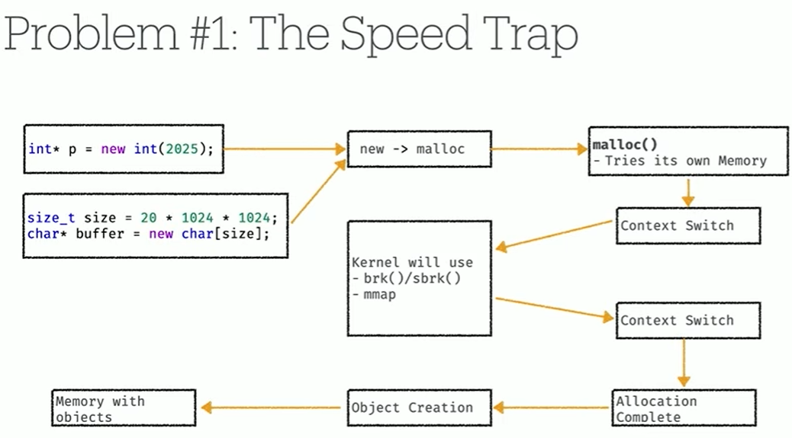

- new probably going to call malloc
- malloc() will try to use its own memory
  - when program starts up it gets its own memory, but if the amount of memory we are trying to allocate is outside the program allocation to begin with
  - its going to do context switch
  - ask kernel for space, which will
    - use mmap
    - or increase program space with brk()/sbrk()
  - context switch back
  - allocation complete
  - Object creation
- Finally have memory with objects

## Problem #2: Memory Chaos

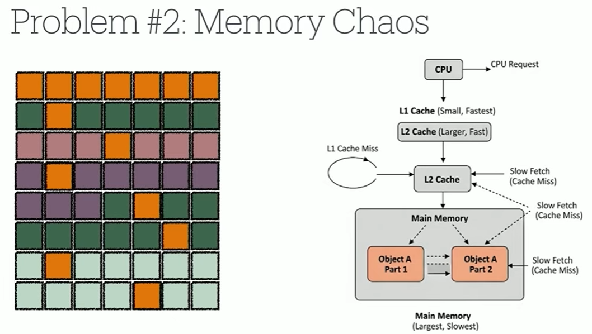
depending on how you allocate your memory, it can get fragmented

beyond fragmentation, we can look at the cache issue

- your CPU gets a request
- if the item you're looking for is in L1 cache, you get it back quickly
- if its not, has to go to L2 cache, if cache miss there, now go to main memory

What happens when you allocated your memory, one object was allocated in a totally different section compared to another object because of fragmentation

- now you have double request, double chance for cache miss and an even farther jump for jump instructions to try to grab your values out of memory

# Why Custom Allocator?

we can take control

- allows allocation to be nearly instantaneous
- can eliminate fragmentation for our key data structures
- could guarantee our data is laid out perfectly for CPU cache

# PMR

pmr with a monotonic buffer, can actually give you a stack based access

- incredibly access to memory by using pmr

# Standard Allocator

```c
std::vector<int, std::allocator<int>> my_vec;
```

std::allocator is C++ standard way of controlling memory that is flexible and extensible

- not used explicitly in everyday code, but extensively in STL

```c
template <typename T>
struct MyAllocator {
  using value_type = T;
  MyAllocator() = default;
  T* allocate(size_t n);
  void deallocate(T*p, size_t n);
}
```

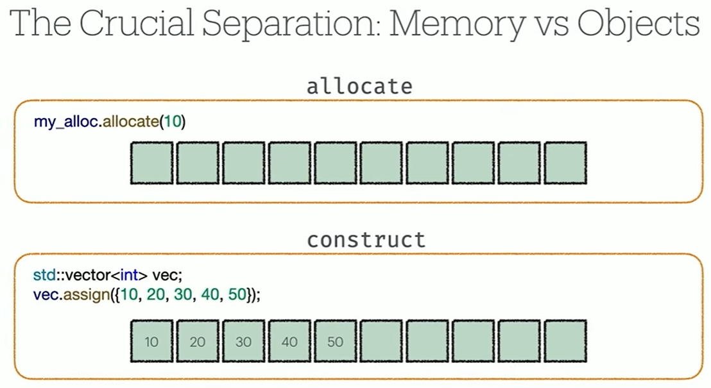
big separation between memory and the object (2 steps)

- we have the allocation, which is making the memory available
- we also have that part where we are assigning the value into the memory

when it comes to writing memory allocation patterns such as stack or pool, that's where we can savings

- if we can allocate a bunch of memory at once
- we can then turn around and reuse that allocation over and over again

## Basic usage

```c
#include <iostream>
#include <memory> // for std::allocator, std::construct_at, std::destroy_at

int main() {
  std::allocator<int> allocator;          // Define an allocator for int
  int *array = allocator.allocate(5);     // Allocate space for 5 ints

  for (int i = 0; i < 5; ++i) { // Construct values in the allocated memory
    std::construct_at(&array[i], i * 10); // Initializes array[i] to i * 10
  }

  for (int i = 0; i < 5; ++i) { std::cout << array[i] << " "; }

  // Destroy the constructed objects then deallocate
  for (int i = 0; i < 5; ++i) { std::destroy_at(&array[i]); }

  allocator.deallocate(array, 5);
}
```

this is the standard pattern when using custom allocators

- you have the part where you allocate the memory
- then constructing and destructing your objects within that memory

# std::allocator_traits (Modern Helper)

```c
my_alloc.construct(p, val); // old way (pre C++11)
std::allocator_traits<MyAlloc>::construct(my_alloc, p, val); // Modern way
```

- provides uniform way to access allocator functionality
- sensible defaults for optional allocator members (construct, destroy, max_size, etc)
- you only need to implement allocate deallocte. allocate_traits handles the rest

# Allocator's Job

- Obey the contract:
  - implement value_type, allocate and deallocate
- Manage raw memory:
  - leave object construction/destruction to container
- Let allocator_traits help:
  - DOn't worry about implementing everything yourself


# Pool Allocator
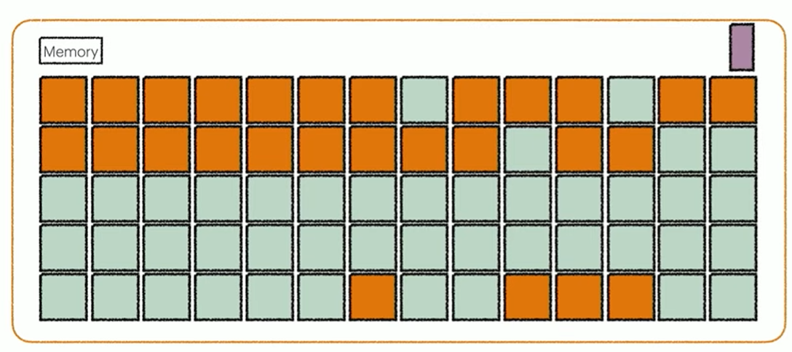
- lighter block = free and avaialble
- orange block = taken


```c
class SimplePoolAllocator{
private:
  alignas(T) char pool_[PoolSize*sizeof(T)];

  struct FreeNode {
    FreeNode* next;
  };

  FreeNode* free_head_ = nullptr;
  size_t allocated_count = 0;
}
```
when you do intrusive pool allocator you use a linked list to track your empty blocks
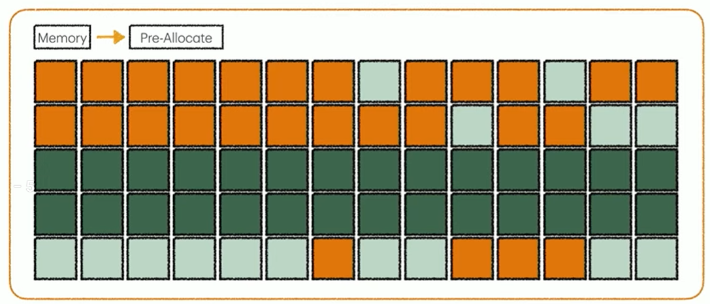
- the dark green is the memory that we allocated already when we started our code
```c
void initialize_pool() {
    // Initialize free list by threading through the pool
    char* current = pool_;
    for (size_t i = 0; i < PoolSize - 1; ++i) {
        reinterpret_cast<FreeNode*>(current)->next =
            reinterpret_cast<FreeNode*>(current + sizeof(T));
        current += sizeof(T);
    }
    // Last node points to nullptr
    reinterpret_cast<FreeNode*>(current)->next = nullptr;
    free_head_ = reinterpret_cast<FreeNode*>(pool_);
}
```
- what we do here is line up our data structure to be able to fit in that pool

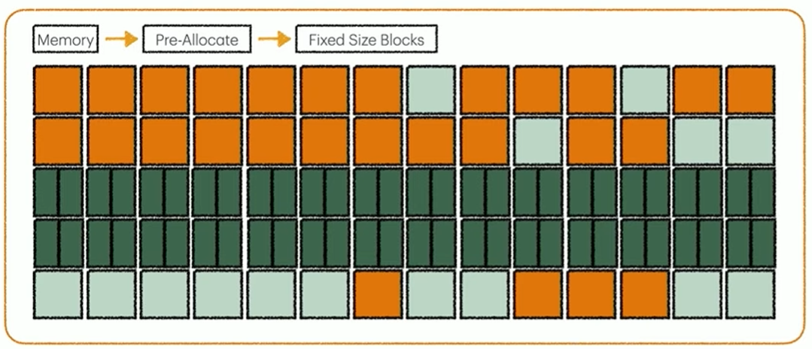
- now our pool would look like this, we would have our separate spots, which each part of our linked list points to a free block
- then we can fill it in

```c
T* allocate() {
    if (free_head_ == nullptr) {
        std::cout << "Pool exhausted!" << std::endl;
        throw std::bad_alloc();
    }

    // Pop from free list
    T* result = reinterpret_cast<T*>(free_head_);
    free_head_ = free_head_->next;
    ++allocated_count_;

    std::cout << "Allocated block #" << allocated_count_
              << " at " << static_cast<void*>(result) << std::endl;

    return result;
}
```
- our allocation is already do, all we're doing here is manually managing hte memory to put our objects where we want them inside this pool
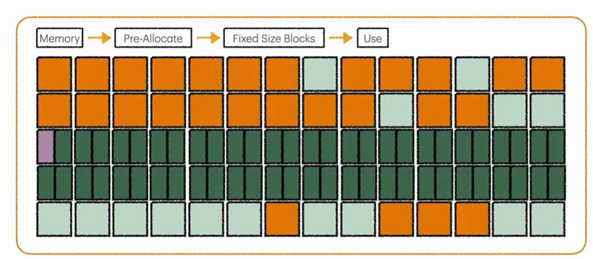


Code: Allocating and Assigning
```c
std::cout << "=== Manual allocation and construction ===\n";
for (int i = 0; i < 34; ++i) {
    // Step 1: Allocate raw memory from pool
    objects[i] = pool.allocate();

    // Step 2: Construct object using placement new
    new(objects[i]) TestObject(i + 1, (i + 1) * 1.5);

    std::cout << "Available after allocation " << (i+1) << ": "
              << pool.available_count() << " slots\n";
} 
```
- doing this over 34 times, we would fill up the blocks in order

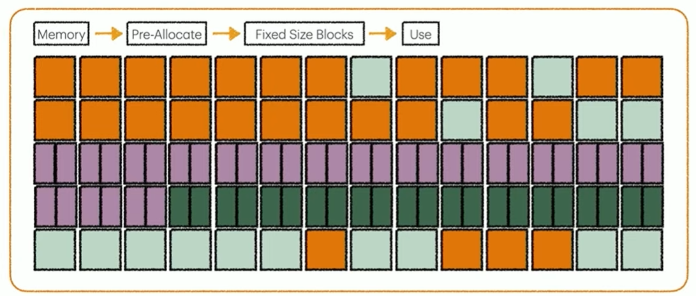

Code: Deallocation
```c
void deallocate(T* p) {
    if (p == nullptr) return;

    if (p < reinterpret_cast<T*>(pool_) ||
        p >= reinterpret_cast<T*>(pool_ + sizeof(pool_))) {
        std::cout << "Warning: pointer not from this pool!" << std::endl;
        return;
    }

    // Push back to free list
    FreeNode* node = reinterpret_cast<FreeNode*>(p);
    node->next = free_head_;
    free_head_ = node;
    --allocated_count_;

    std::cout << "Deallocated block, " << allocated_count_
              << " still allocated" << std::endl;
}
```
- deallocates in reverse

Code: Reclaiming
```c
for (int i = 0; i < 4; ++i) {
    // Step 1: Manually call destructor
    objects[i]->~TestObject();

    // Step 2: Return memory to pool
    pool.deallocate(objects[i]);

    std::cout << "Available after deallocation " << (i+1) << ": "
              << pool.available_count() << " slots\n";
}
```

Code : allocator_traits
```c
// Shorthand for the allocator_traits type
using AllocTraits = std::allocator_traits<SimplePoolAllocator<TestObject>>;

for (int i = 0; i < 4; ++i) {
    // allocator_traits provides a standard interface
    objects[i] = AllocTraits::allocate(pool, 1);
    AllocTraits::construct(pool, objects[i], i + 1, (i + 1) * 1.5);
}

std::cout << "\n=== Cleaning up with allocator_traits ===\n";
for (int i = 0; i < 4; ++i) {
    // allocator_traits handles destruction and deallocation
    AllocTraits::destroy(pool, objects[i]);
    AllocTraits::deallocate(pool, objects[i], 1);
}
```

# Stack Allocator
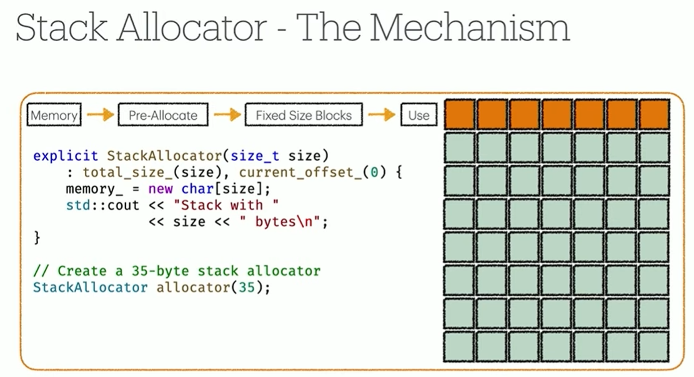
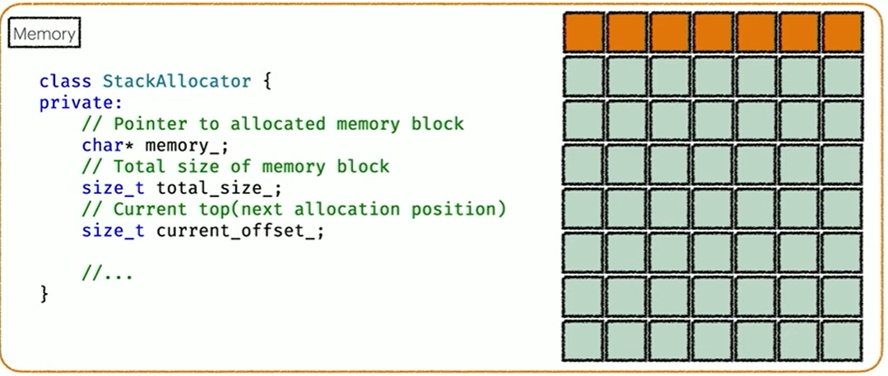
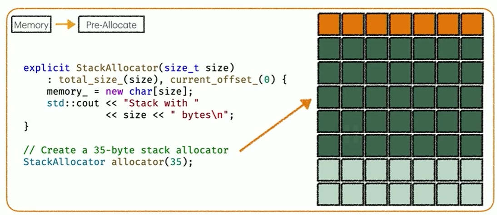
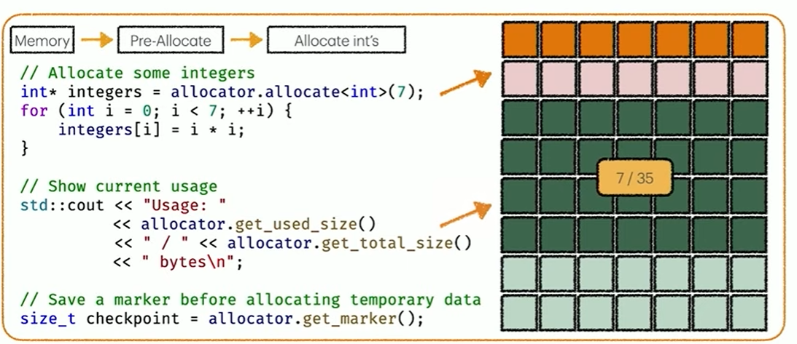

with stack allocation pattern, you are not stuck to one type of object,
 you can use multiple types, and it is still a very fast allocation because the actual memory was allocated all in the beginning of the call
 - all we are doing is creating these objects inside the memory that we already have

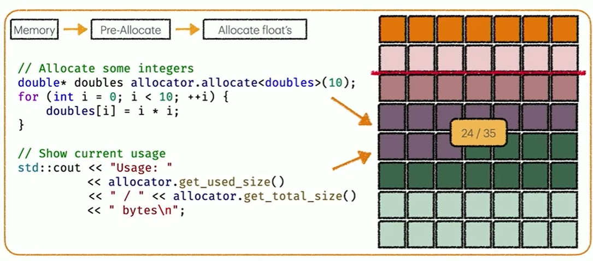

We can only deallocate everything else before you can deallocate a block!
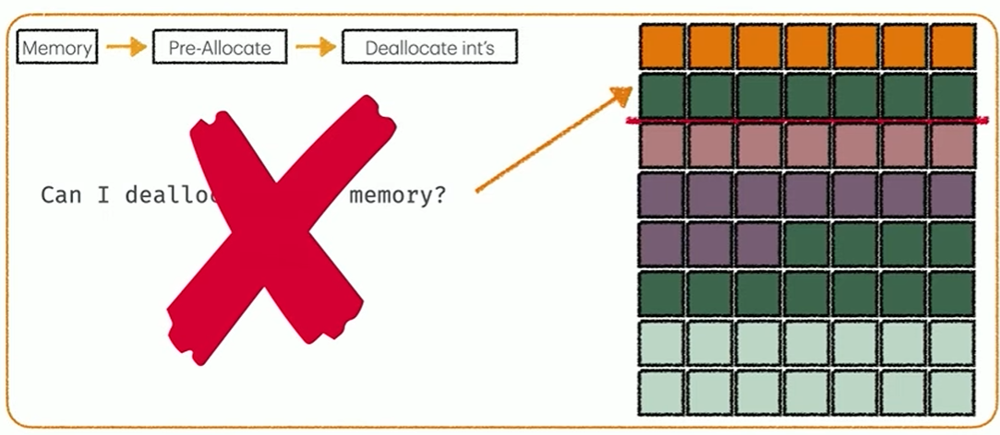

Using checkpoint markers, which we can use multiple
- it becomes very fast to deallocate back to a check point marker

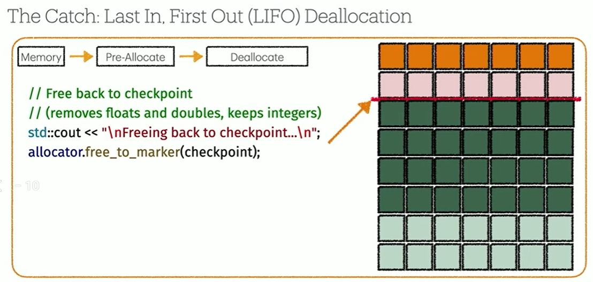

# Summary of Designs
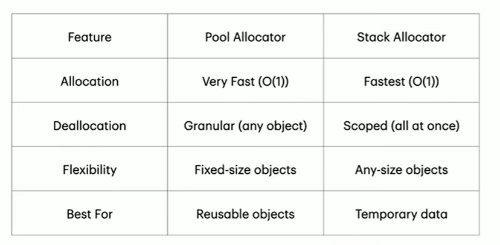

| Property | Pool | Stack |
|---|---|---|
| **Summary** | Recycles objects of the same size | Ultra fast and temporary |
| **Object size** | Single, fixed | Any (LIFO) |
| **Speed** | Extremely fast | Fastest possible |
| **Fragmentation** | None (per object type) | None |
| **Free cost** | Return to free list | Move a single pointer |
| **Free order** | Any | LIFO only |
| **Upfront cost** | Potentially large block | Large block |
| **Lifetime support** | Any | Short-lived |
| **Best for** | Nodes in list/tree/graph, game objects (bullets, enemies, particles), same-size create/destroy churn | Scratchpad memory, per-frame allocations, short-lived data |

# Practical Implementation: TrackingAllocator
