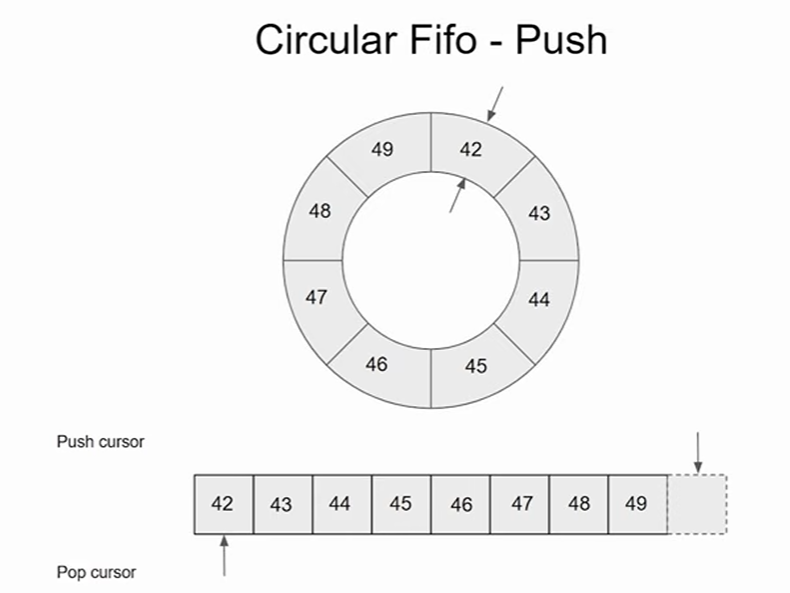
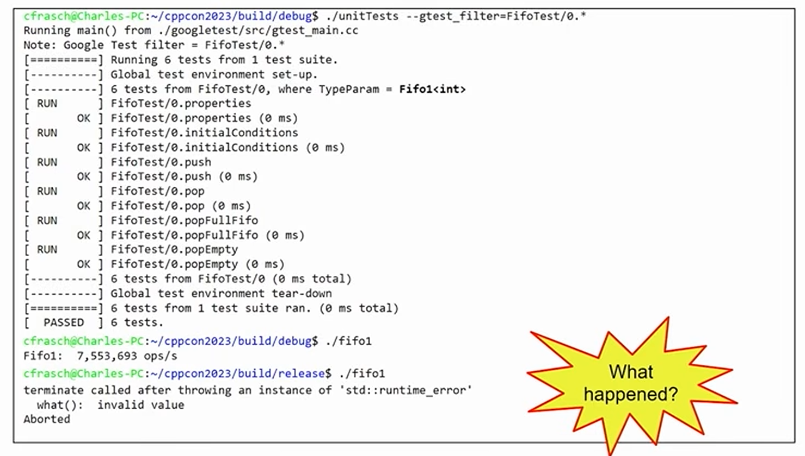
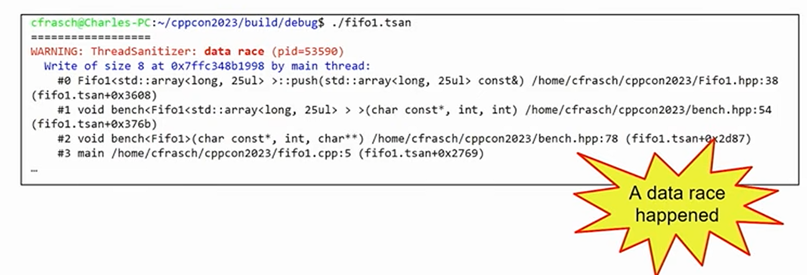
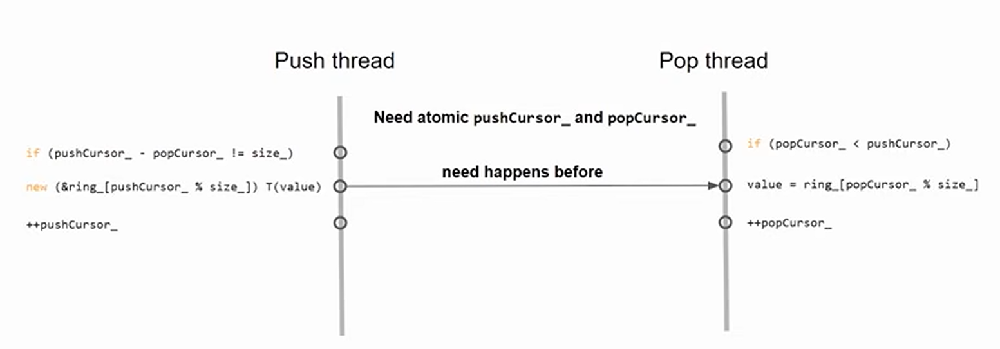
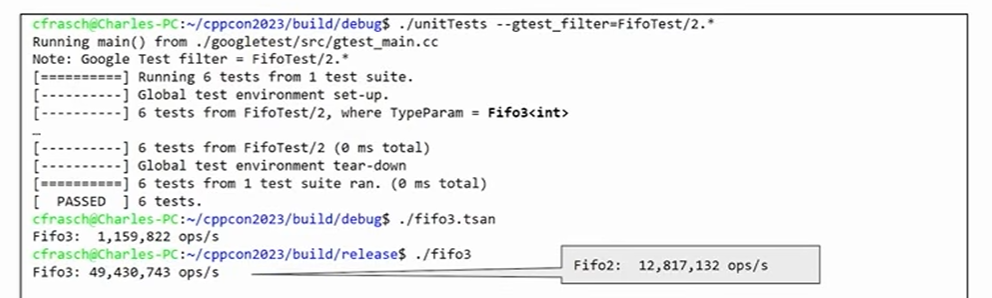
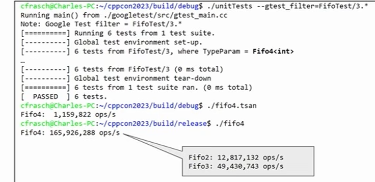
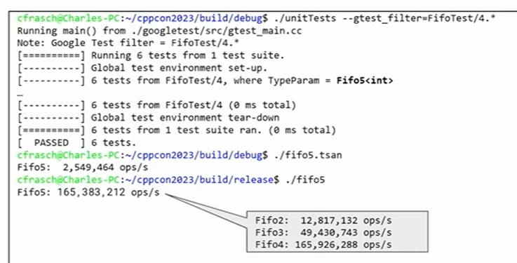
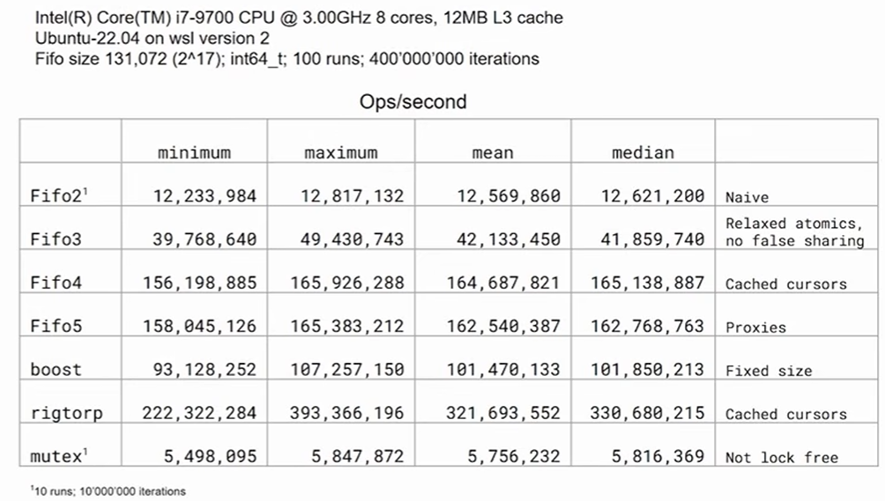
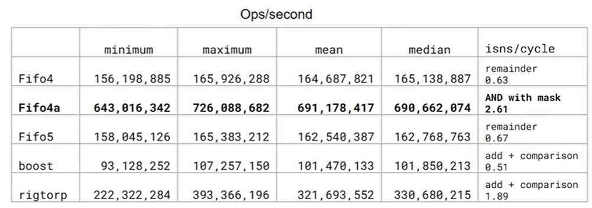

# Single Producer Single Consumer Lock-free FIFO From the Ground Up - Charles Frasch - CppCon 2023
https://www.youtube.com/watch?v=K3P_Lmq6pw0&t=650s

Single Producer Single Consumer Lock-Free Wait-Free Fifo

- Single producer: one producer/writer thread
- Single consumer: one consumer/reader thread
- Lock-free: doesn't use mutex locks. At any point of time, some thread will make progress
- Wait-free: each thread moves forward regardless of other threads
- [Circular] Fifo [or Queue]: a single, fixed-size buffer as if it were connected end-to-end. Oldest entry is processed first

## What do we use SPSC FIFOs for?


- create a pipeline of processes
- suppose you have 1 thread reading from sockets
  - another thread handles message that comes out of the stocket and produces a result
  - third thread writes a response to network
- these can be connected SPSC FIFO

Advantages:

- it may improve throughput over a single thread doing all 3 of those operations
- should improve resiliency of the application to spikes in message traffic

Disadvantages:

- have to manage 3 threads
- uses more memory, since each of the FIFOs needs place to store its messages

## Circular Fifo



64 bit unsigned integers so there are lots of numbers availalbe for use

- start at 0, everytime we do a push we increment, and probably you won't run out of them (especially if system reboots periodically)
- when you pop a value you remove it from the location where the pop cursor pointed to and increment pop cursor
- eventually, if no new values get added on, the pop cursor becomes equal to push cursor, and fifo becomes empty

To convert continuously increasing cursor value to offset in array

- can do it using the remainder operation (slow operation)
- can also constrain cursor to the allowable range of indices on the array that is storing the values
- can constrain capacity of FIFO to integral power of 2, and use the & operator with capacity-1

## Implementation 1

```c
template<typename T, typename Alloc = std::allocator<T>>
class Fifo1 : private Alloc
{
    std::size_t capacity_;
    T* ring_; // pointer to first element thats allocated in our allocator
    std::size_t pushCursor_{};
    std::size_t popCursor_{};

public:
    explicit Fifo1(std::size_t capacity, Alloc const& alloc = Alloc{})
    : Alloc{alloc}, capacity_{capacity}, ring_{std::allocator_traits::allocate(*this, capacity)}
    {}
    ~Fifo1() {
        while(not empty()) {
            ring_[popCursor_ % capacity_].~T();
            ++popCursor_;
        }
        std::allocator_traits::deallocate(*this, ring_, capacity_);
    }

    auto capacity() const { return capacity_; }
    auto size() const { return pushCursor_ - popCursor_; }
    auto empty() const { return size() == 0; }
    auto full() const { return size() == capacity(); }

    auto push(T const& value) {
      if (full()) return false;
      new (&ring_[pushCursor_ % capacity_]) T(value);
      ++pushCursor_;
      return true;
    }

    auto pop(T& value) {
      if (empty()) return false;
      value = ring_[popCursor_%capacity_];
      ring_[popCursor%capacity_].~T();
      ++popCursor_;
      return true;
    }
};
```

`std::allocator_traits::allocate(*this, capacity)`

- allocation allocates (capacity \* sizeof(T)) bytes as if the global new operator were used
- then it starts the lifetime in an array of T in that storage location
- but it doesn't start the lifetime of any T's

push/pop

- no loops
- no atomic compare/sets
- it goes through in a finite number of steps, and immediately returns
- this is what gives us the wait-free
  
  To test:
  Unit test on operations

Write performance benchmark (debug)

- push number of values onto the FIFO on one thread
- read that same number of values off the FIFO on another thread
- verify value pushed in == value popped (if differ => exception)
- get ops/s

compile and run performance benchmark (release)

- results in a std::runtime_error
- value read in pop thread was not expected values

use ThreadSantitizer to find that we have 4 data race


## Implementation 2 : use atomic push/popCursor to establish happensBefore



```c
template<typename T, typename Alloc = std::allocator<T>>
class Fifo2 : private Alloc
{
    std::size_t capacity_;
    T* ring_;
    std::atomic<std::size_t> pushCursor_{};
    std::atomic<std::size_t> popCursor_{};
    static_assert(std::atomic<std::size_t>>::is_always_lock_free);
public:
    explicit Fifo1(std::size_t capacity, Alloc const& alloc = Alloc{})
    : Alloc{alloc}, capacity_{capacity}, ring_{std::allocator_traits::allocate(*this, capacity)}
    {}
    ~Fifo1() {
        while(not empty()) {
            ring_[popCursor_ % capacity_].~T();
            ++popCursor_;
        }
        std::allocator_traits::deallocate(*this, ring_, capacity_);
    }

    auto capacity() const { return capacity_; }
    auto size() const { return pushCursor_ - popCursor_; }
    auto empty() const { return size() == 0; }
    auto full() const { return size() == capacity(); }

    auto push(T const& value) {
      if (full()) return false;
      new (&ring_[pushCursor_ % capacity_]) T(value);
      ++pushCursor_;
      return true;
    }

    auto pop(T& value) {
      if (empty()) return false;
      value = ring_[popCursor_%capacity_];
      ring_[popCursor%capacity_].~T();
      ++popCursor_;
      return true;
    }
};
```

important to add static assertion that will trigger if our atomic variable are not always lock free

- because standard doesn't require lock free for every type, only std::atomic_flag

## Implementation 3 : avoid false sharing and use different memory ordering on atomic operations

False sharing:

- push/pop cursor were declared right next to each other
- chances are those variables resided on the same cache line
- modern processors use caching, since its a long haul between the memory and the processing core (reduce that by creating cache lines)
  - cache lines on Intel are 64-bytes
  - there's usually separate caches for each core
- we can fix this by aligning our cursors

```c
alignas(std::hardware_destructive_interference_size) std::atomic<std::size_t> pushCursor_;
```

- std::hardware_destructive_interference_size (C++20) constant that evaluates to 64 which puts each cursor on its very own cache line

```c
char padding_[std::hardware_destructive_interference_size - sizeof(std::size_t)];
```

- additionally we use padding to avoid false sharing with adjacent objects

```c
template<typename T, typename Alloc = std::allocator<T>>
class Fifo3 : private Alloc
{
    std::size_t capacity_;
    T* ring_;
    static_assert(std::atomic<std::size_t>::is_always_lock_free);

    alignas(std::hardware_destructive_interference_size) std::atomic<std::size_t> pushCursor_;
    alignas(std::hardware_destructive_interference_size) std::atomic<std::size_t> popCursor_;

    // Padding to avoid false sharing with adjacent objects
    char padding_[std::hardware_destructive_interference_size - sizeof(std::size_t)];

    auto full(std::size_t pushCursor, std::size_t popCursor) const { return (pushCursor - popCursor) == capacity_; }
    static auto empty(std::size_t pushCursor, std::size_t popCursor) { return pushCursor == popCursor; }
    auto element(std::size_t cursor) { return &ring_[cursor % capacity_]; }

public:
    explicit Fifo3(std::size_t size, Alloc const& alloc = Alloc()) ...
    ~Fifo3() ...

    auto capacity() const ...
    auto size() const ...
    auto empty() const ...
    auto full() const ...

    auto push(T const& value);
    auto pop(T* value);
};
```

default operations on atomic variables carry sequentially consistent memory ordering

- it provides total ordering in the entire program in the order in which the atomic variables are read
- we don't need this, we only require the release/acquire semantics

```c
auto Fifo3::push(T const& value) {
    auto pushCursor = pushCursor_.load(std::memory_order_relaxed);
    auto popCursor = popCursor_.load(std::memory_order_acquire);
    if (full(pushCursor, popCursor)) {
        return false;
    }
    new (element(pushCursor)) T(value);
    pushCursor_.store(pushCursor + 1, std::memory_order_release);
    return true;
}

auto Fifo3::pop(T& value) {
    auto pushCursor = pushCursor_.load(std::memory_order_acquire);
    auto popCursor = popCursor_.load(std::memory_order_relaxed);
    if (empty(pushCursor, popCursor)) {
        return false;
    }
    value = *element(popCursor);
    element(popCursor)->~T();
    popCursor_.store(popCursor + 1, std::memory_order_release);
    return true;
}
```



- about a 4x improvement over Fifo2

## DO

- Fiddle around with Fifo2, and see the different effects
  - betweeen false sharing and not false sharing
  - relaxed atomics vs not relaxed atomics

## Implementation 4:

On the push thread

- Unless Fifo is full in the push thread, we don't really need to actually read the current value of the pop thread, so we can cache it

On the pop thread

- you only really care knowing about the push thread is when the Fifo is empty

```c
alignas(std::hardware_destructive_interference_size) std::atomic<std::size_t> pushCursor_;
alignas(std::hardware_destructive_interference_size) std::size_t cachedPopCursor_{};
alignas(std::hardware_destructive_interference_size) std::atomic<std::size_t> popCursor_{};
alignas(std::hardware_destructive_interference_size) std::size_t cachedPushCursor_;
```

we create two more aligned cursors, cachedPopCursor and cachedPushCursor

- they don't need to atomic variables
- they are loaded and stored by their own thread
  - push thread loads and stores the cachedPopCursor
  - pop thread loads and stores the cachedPushCursor

```c
auto Fifo4::push(T const& value) {
    auto pushCursor = pushCursor_.load(std::memory_order_relaxed);
    if (full(pushCursor, cachedPopCursor_)) {
        cachedPopCursor_ = popCursor_.load(std::memory_order_acquire);
        if (full(pushCursor, cachedPopCursor_)) {
            return false;
        }
    }
    new (&ring_[pushCursor % capacity_]) T(value);
    pushCursor_.store(pushCursor + 1, std::memory_order_release);
    return true;
}

auto Fifo4::pop(T& value) {
    auto popCursor = popCursor_.load(std::memory_order_relaxed);
    if (empty(cachedPushCursor_, popCursor)) {
        cachedPushCursor_ = pushCursor_.load(std::memory_order_acquire);
        if (empty(cachedPushCursor_, popCursor)) {
            return false;
        }
    }
    value = ring_[popCursor % capacity_];
    ring_[popCursor % capacity_].~T();
    popCursor_.store(popCursor + 1, std::memory_order_release);
    return true;
}
```

The cachedCursors were default initalized {} to 0 when Fifo was created

- when we wanna push a value, we get our push cursor and we compare it with the cached pop cursor, if it's not full, we continue with the rest of the operations
- if it is full, we load the pop cursor using memory_order_acquire, and store it in the cachedPopCursor
- and recompute whether the Fifo was full, if it is full this time return false, else continue



- over 3x over Fifo 3

## Implemenation 5: How to optimize number of memcpys

```c
struct Foo { int bar; int blat; ... };
static_assert(std::is_implicit_lifetime_v<Foo>); // See P2674R0
Fifo4<Foo> fifo(1024);

// called in thread 1
void readAndPushFoo(int sock, Fifo4<Foo>& fifo) {
    alignas(Foo) unsigned char buffer[sizeof(Foo)];
    ::read(sock, buffer, sizeof(Foo)); // memcpy
    auto foo = std::start_lifetime_as<Foo>(buffer);
    if (foo->bar != someValue) throw std::runtime_error("bad bar");
    fifo.push(*foo); // memcpy
}

// called in thread 2
void popAndSendFoo(int sock, Fifo4<Foo>& fifo) {
    Foo foo;
    if (!fifo.pop(foo)) return; // memcpy
    foo.blat = someBlatValue;
    ::write(sock, std::addressof(foo), sizeof(Foo)); // memcpy
}
```

memcpy for pretty big structs take a long time, and dominates the operations on any kind of FIFO

```c
struct Foo {int bar; int blat; ...};
static_assert(std::is_trivial_v<Foo>);
Fifo5<Foo> fifo(42);

// called in thread 1
void readAndPushFoo(int rsock, Fifo5<Foo>& fifo) {
    auto pusher = fifo.push();
    ::read(rsock, pusher.get(), sizeof(Foo)); // memcpy
    if (pusher->bar != someValue) {
        pusher.release();
        throw std::runtime_error("bad bar");
    }
}

// called in thread 2
void popAndSendFoo(int wsock, Fifo5<Foo>& fifo) {
    auto popper = fifo.pop();
    if (!popper) return;
    popper->blat = someBlatValue;
    ::write(wsock, popper.get(), sizeof(Foo)); // memcpy
}
```

we create some kind of smart pointer like object pusher/popper

- we can use the get() on that pusher to get at the memory inside the FIFO at the push cursor
- we use that as the place the socket read is going to deposit all its bytes
- when we get back from that, since pusher is a smart pointer, we can dereference the bar and test its value
  - we want to release that pusher beforehand
  - because when the readAndPush Fifo returns, the destructor of our pusher is going to want to advance the push cursor

we can cut # of memcpy in half

```c
template<typename T, typename Alloc = std::allocator<T>>
class Fifo5 : private Alloc requires std::is_trivial_v<T>
{
    size_t mask_;
    T* ring_;
    static_assert(std::atomic<std::size_t>::is_always_lock_free);
    alignas(hardware_destructive_interference_size) std::atomic<std::size_t> pushCursor_;
    alignas(hardware_destructive_interference_size) std::size_t cachedPopCursor_;
    alignas(hardware_destructive_interference_size) std::atomic<std::size_t> popCursor_;
    alignas(hardware_destructive_interference_size) std::size_t cachedPushCursor_;

    auto element(std::size_t cursor) ...
    auto full(std::size_t pushCursor, std::size_t popCursor) const ...
    static auto empty(std::size_t pushCursor, std::size_t popCursor) ...

public:
    explicit Fifo5(std::size_t size, Alloc const& alloc = Alloc()) ...
    ~Fifo5() ...

    auto capacity() const ...
    auto size() const ...
    auto empty() const ...
    auto full() const ...

    class pusher_t;
    pusher_t push();
    bool push(T const& value);

    class popper_t;
    popper_t pop();
    bool pop(T* value);
};
```

### pusher
```c
class Fifo5::pusher_t {
    Fifo5* fifo_{};
    std::size_t cursor_;

public:
    pusher_t() = default;
    explicit pusher_t(Fifo5* fifo, std::size_t cursor) : fifo_{fifo}, cursor_{cursor} {}

    // Not copyable; is movable

    ~pusher_t() {
        if (fifo_) {
            fifo_->pushCursor_.store(cursor_ + 1, std::memory_order_release);
        }
    }
    explicit operator bool() const { return fifo_; }
    void release() { fifo_ = {}; }

    T* get() { return fifo_->element(cursor_); }
    T const* get() const { return fifo_->element(cursor_); }
    T* operator->() { return get(); }
    T const* operator->() const { return get(); }
};

Fifo5::pusher_t Fifo5::push() {
    auto pushCursor = pushCursor_.load(std::memory_order_relaxed);
    if (full(pushCursor, cachedPopCursor_)) {
        cachedPopCursor_ = popCursor_.load(std::memory_order_acquire);
        if (full(pushCursor, cachedPopCursor_)) {
            return pusher_t{};
        }
    }
    return pusher_t(this, pushCursor);
}

bool Fifo5::push(T const& value) {
    auto pusher = push();
    if (pusher) {
        *pusher = value;
        return true;
    }
    return false;
}
```

### popper
```c
class Fifo5::popper_t {
    Fifo5* fifo_{};
    std::size_t cursor_;

public:
    popper_t() = default;
    explicit popper_t(Fifo5* fifo, std::size_t cursor) : fifo_{fifo}, cursor_{cursor} {}

    // Not copyable; is movable

    ~popper_t() {
        if (fifo_) {
            fifo_->popCursor_.store(cursor_ + 1, std::memory_order_release);
        }
    }
    explicit operator bool() const { return fifo_; }
    void release() { fifo_ = {}; }

    T* get() { return fifo_->element(cursor_); }
    T const* get() const { return fifo_->element(cursor_); }
    T* operator->() { return get(); }
    T const* operator->() const { return get(); }
};

Fifo5::popper_t Fifo5::pop() {
    auto popCursor = popCursor_.load(std::memory_order_relaxed);
    if (empty(cachedPushCursor_, popCursor)) {
        cachedPushCursor_ = pushCursor_.load(std::memory_order_acquire);
        if (empty(cachedPushCursor_, popCursor)) {
            return popper_t{};
        }
    }
    return popper_t{this, popCursor};
}

bool Fifo5::pop(T& value) {
    auto popper = pop();
    if (popper) {
        value = *popper;
        return true;
    }
    return false;
}
```

- basically same as FIFO 4, slightly less because of the branch, and the destructor, etc

## Final results



- by constraining the capacity size to integral power of 2 and using AND operation to compute the index into the array
  - isns/cycle 2.61
  - generally the better the performance the better isns/cycle
